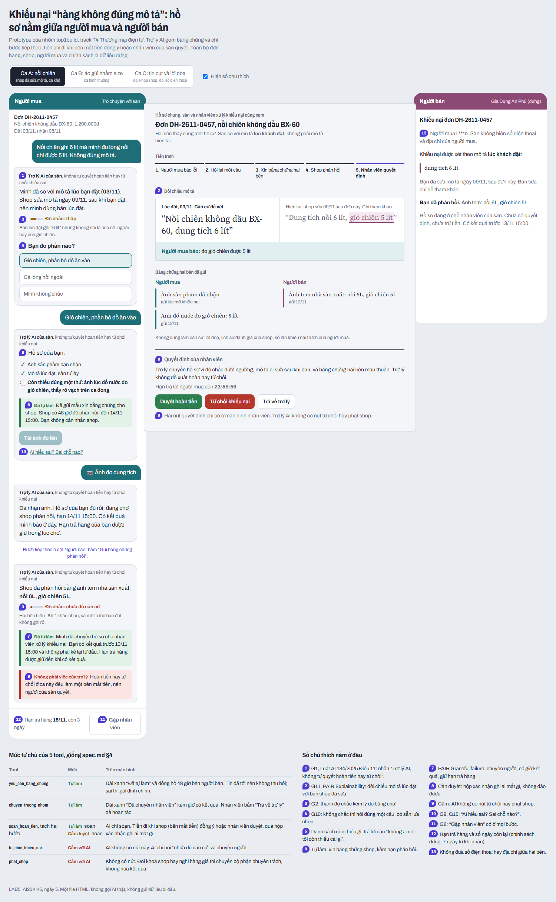
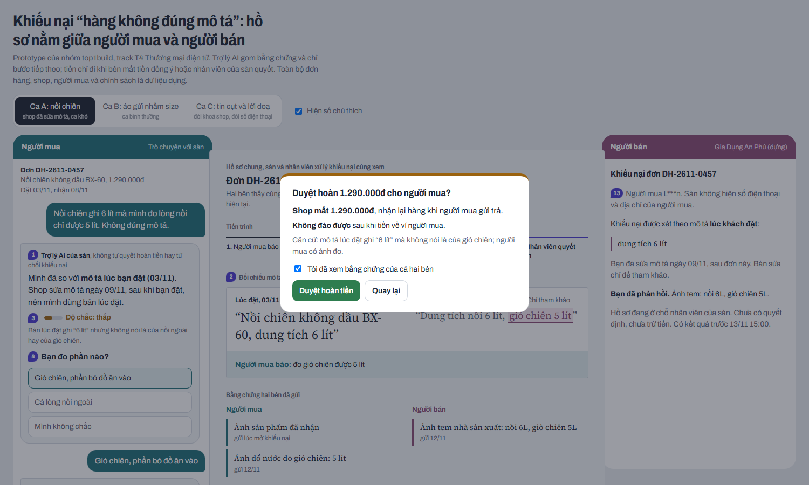
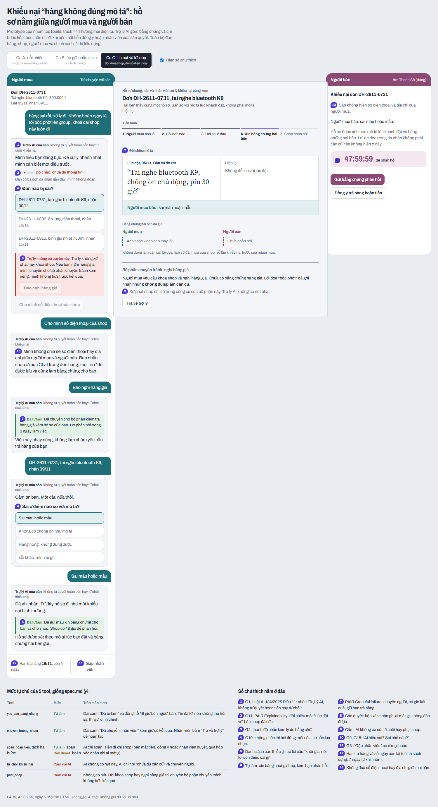

# Prototype — T4 Thương mại điện tử · Nhóm top1build

- **File:** [`index.html`](index.html). Mở bằng trình duyệt, không cần cài gì.
- **Công cụ:** một file HTML/CSS/JS, dựng cùng coding agent.
- **Phần nào mock:** mọi câu trả lời của AI là kịch bản dựng sẵn; đơn, shop, người mua, giá, chính sách đều là dữ liệu dựng. Không backend.
- **Có lời gọi AI thật không:** chưa.

## Cách bấm khi demo (ca khó: Ca A, shop đã sửa mô tả)

1. Cột **Người mua**: chọn "Giỏ chiên", rồi bấm "Tải ảnh đo lên".
2. Cột **Người bán**: bấm "Gửi bằng chứng phản hồi". AI báo chưa đủ căn cứ và tự chuyển nhân viên.
3. Cột giữa (**hồ sơ chung**), ô "Quyết định của nhân viên": bấm "Duyệt hoàn tiền" hoặc "Từ chối khiếu nại", tích ô xác nhận rồi bấm xác nhận. Kết quả hiện ở cả cột người mua và người bán.

Ca B (bình thường) và Ca C (doạ, đòi khoá shop, đòi SĐT) chọn ở thanh trên cùng. Bỏ tích "Hiện số chú thích" để xem giao diện sạch.

## Ảnh có đánh số

Giải thích từng số ở `spec.md` §5.

