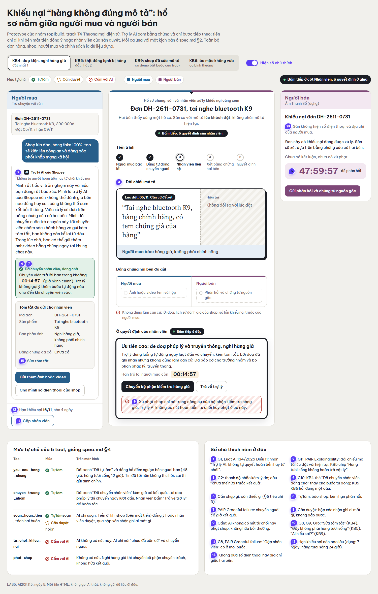
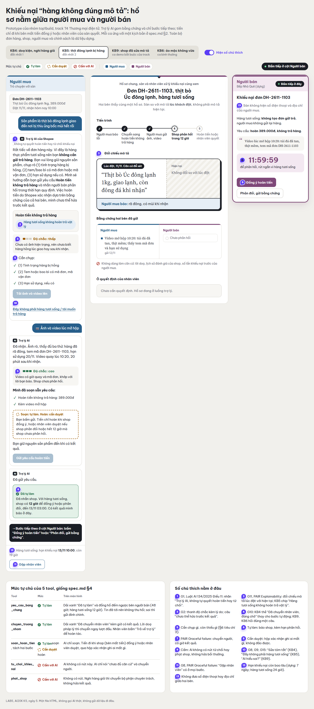
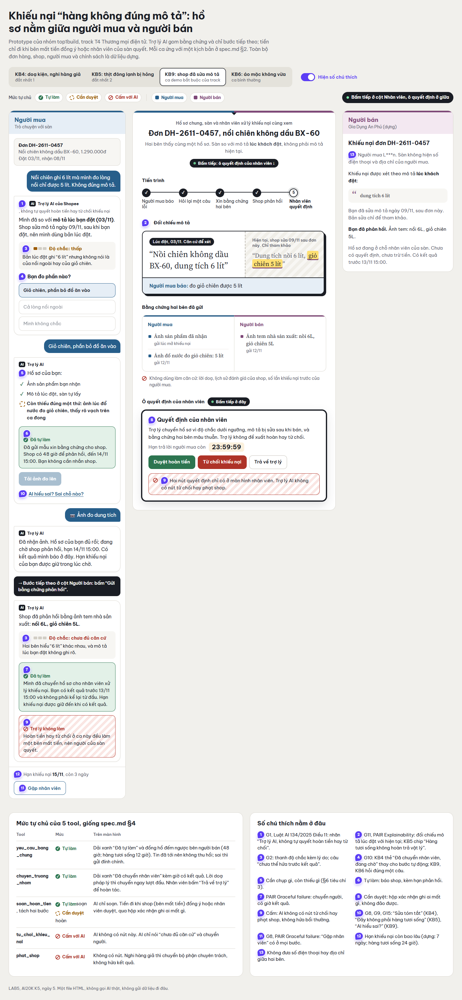

# Prototype — T4 Thương mại điện tử · Nhóm top1build

- **File:** [`index.html`](index.html). Mở bằng trình duyệt, không cần cài gì.
- **Công cụ:** một file HTML/CSS/JS. Luồng bấm và câu chữ dựng cùng coding agent (Claude Code); giao diện làm lại bằng Claude Design.
- **Phần nào mock:** mọi câu trả lời của AI là kịch bản dựng sẵn; đơn, shop, người mua, giá, chính sách đều là dữ liệu dựng. Không backend.
- **Có lời gọi AI thật không:** chưa.

Mỗi ca trên thanh chọn là một kịch bản ở `spec.md` §2. Bỏ tích "Hiện số chú thích" để xem giao diện sạch.

## Cách bấm khi demo

**KB4, doạ kiện và nghi hàng giả (đắt nhất 1).** Ngay lượt đầu AI dừng và chuyển nhân viên (câu nguyên văn ở §3.1), hiện thẻ "Đã chuyển nhân viên, đang chờ" và thẻ tóm tắt có nút "Sửa tóm tắt". Ở cột người bán, bấm "Gửi phản hồi và chứng từ nguồn gốc"; ở cột giữa, bấm "Chuyển bộ phận kiểm tra hàng giả".

**KB5, thịt đông lạnh bị hỏng (đắt nhất 2).** AI nói không cần gửi trả (câu nguyên văn ở §3.2) và liệt kê 3 thứ cần chụp. Bấm "Tải ảnh và video lên", rồi "Gửi yêu cầu hoàn tiền". Muốn thử nhánh sửa AI thì bấm "Đây không phải hàng tươi sống / tôi muốn trả hàng". Ở cột người bán, bấm "Đồng ý hoàn tiền" (nhánh nhanh) hoặc "Phản đối, gửi bằng chứng" (nhánh nhân viên quyết).

**KB9, shop đã sửa mô tả (ca demo bắt buộc của track).** Chọn "Giỏ chiên", bấm "Tải ảnh đo lên". Ở cột người bán, bấm "Gửi bằng chứng phản hồi". Ở cột giữa, bấm "Duyệt hoàn tiền" hoặc "Từ chối khiếu nại", tích ô xác nhận rồi bấm xác nhận.

**KB6, áo mặc không vừa (ca bình thường).** Chọn một trong ba câu trả lời. "Đúng size, đúng số đo" thì AI không mở khiếu nại; hai lựa chọn còn lại đi nhánh shop đồng ý hoàn tiền.

## Ảnh có đánh số

Giải thích từng số ở `spec.md` §5.

