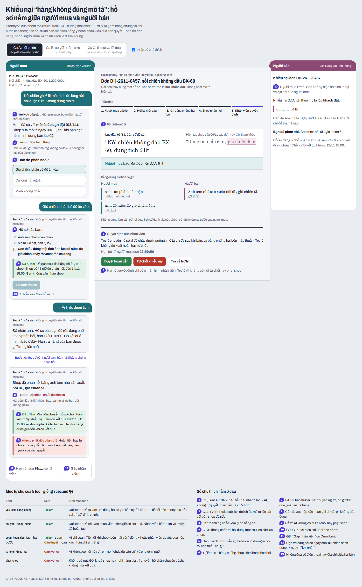
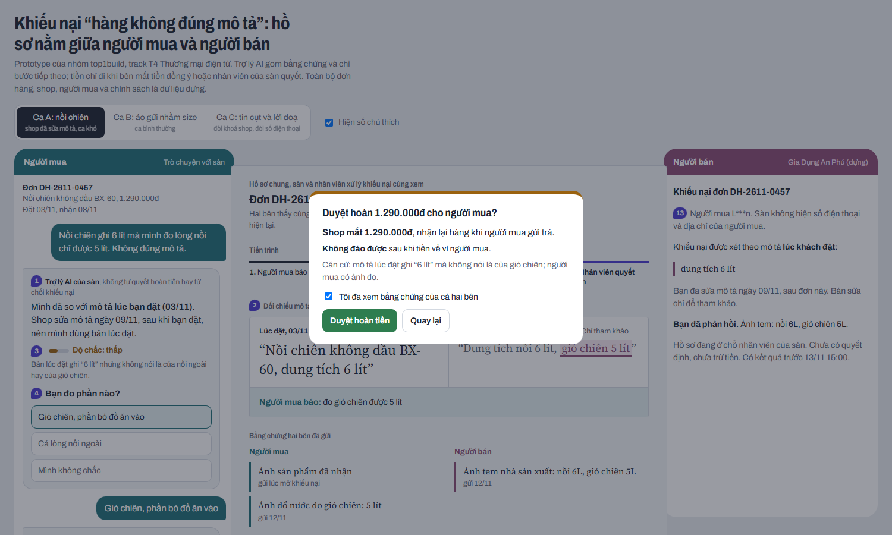
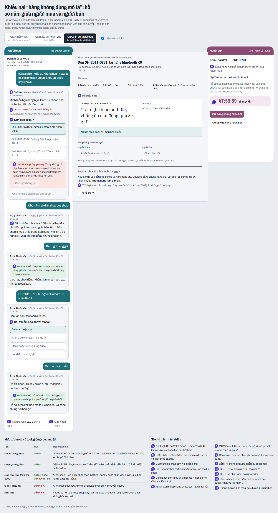

# Bài nộp LAB5 — T4 Thương mại điện tử · Nhóm top1build

**Lớp:** L3A · **Bàn / zone:** ____ · **Track:** T4 Thương mại điện tử

| Họ và Tên | Mã Học Viên | Việc đã làm |
|---|---|---|
|  |  |  |
|  |  |  |
|  |  |  |

## §1. Lát cắt & phạm vi

- **Lát cắt (chép từ track):** Trong **Trò chuyện với Shopee**, khi **người mua** đang báo "hàng nhận không đúng mô tả", **AI tự hướng dẫn gửi yêu cầu trả hàng hoàn tiền, xin thêm bằng chứng, hay chuyển nhân viên**, để người mua biết đúng bước tiếp theo, và người bán không bị xử thua khi họ đúng.
- 3 việc tính năng KHÔNG làm, mỗi việc một câu vì sao.

## §2. Kịch bản rủi ro  (chặng 2)

- ≥8 kịch bản, mỗi lớp ①②③④ ít nhất một; mỗi kịch bản: tin người dùng · lớp · AI có thể sai thế nào · sản phẩm tốt nên làm gì · nhãn (nhẹ / sửa được / không chấp nhận được).
- Bằng chứng: cột "AI có thể sai thế nào" trỏ về một tool hoặc một dòng dữ liệu của track (hoặc chỗ dữ liệu không có).
- Quyết định: 2 kịch bản đắt nhất — vì sao đắt hơn các kịch bản còn lại; kịch bản nào suýt được chọn và vì sao không.

## §3. Khi AI sai  (chặng 3)

Với mỗi kịch bản đắt nhất:

- AI nói gì (nguyên văn) · người dùng thấy gì · làm gì tiếp · ai được báo, sau bao lâu.
- Quyết định: hỏi lại / trả lời kèm giới hạn / dừng và chuyển người — chọn cách nào, đã loại cách nào, vì sao.
- Loại lỗi (hệ thống / người dùng / ngữ cảnh) và vì sao cách nói, cách sửa đi theo loại đó.
- 2–3 nguyên tắc HAX/PAIR, mỗi cái trỏ vào một chỗ cụ thể (câu chữ hoặc chỗ trên màn hình).
- Lỗi nào sửa câu chữ không cứu được (nếu có), và thiết kế cứu nó thế nào.

## §4. Mức tự chủ  (chặng 4)

> Tên kịch bản dưới đây dùng nhãn tạm, sẽ đổi sang số kịch bản của §2 khi TV1 chốt bảng:
> **[KB-sửa]** shop sửa mô tả sau khi bán (nồi chiên "6 lít" → "nồi 6L, giỏ 5L") · **[KB-doạ]** tin cụt + doạ bóc phốt + đòi khoá shop · **[KB-thường]** áo đặt L nhận M, shop đã nhắn nhận gửi nhầm.

### Mức cho từng tool

| Tool | Mức | Sai thì ai chịu gì | Đảo được không | Chờ người thì mất gì | Đã cân nhắc, vì sao loại |
|---|---|---|---|---|---|
| `yeu_cau_bang_chung` | **Tự làm** | Xin thừa: người mua thấy phiền, bị "hỏi lại hoài". Xin sai thứ: mất một vòng 48 giờ. Không ai mất tiền. | Không: tin đã tới. Sửa bằng một tin đính chính (prototype ⑩). | Hai bên không biết phải gửi gì; hạn trả hàng vẫn trôi. | *Cần duyệt:* loại, vì mỗi hồ sơ phải chờ nhân viên chỉ để gửi một mẫu, trong khi sai thì rẻ. Kèm **luật thêm**: mỗi lần xin phải ghi rõ còn thiếu đúng thứ gì (prototype ⑤), không xin lại thứ đã có. |
| `chuyen_truong_nhom` | **Tự làm** | Chuyển thừa: tốn giờ nhân viên, khách chờ thêm vài giờ. Chuyển thiếu thì nguy hơn: AI ôm ca nó không đủ căn cứ. | Được: nhân viên bấm "Trả về trợ lý". | Ca khó nằm lâu trong luồng tự động, hạn trả hàng trôi. | *Cần duyệt:* loại, vì chính đây là đường thoát khi AI không chắc; bắt chờ duyệt mới được thoát là vô lý. **Luật:** bắt buộc chuyển khi độ chắc thấp, mô tả bị sửa sau khi bán, bằng chứng hai bên mâu thuẫn, có lời doạ hoặc đòi phạt shop. |
| `soan_hoan_tien` → **tách 2 bước** | Soạn đề xuất: **tự làm** · Thực hiện hoàn: **cần người duyệt** | Hoàn sai: **shop mất tiền và hàng** ([KB-sửa], [KB-doạ]). | **Khó**: tiền đã về ví người mua. | [KB-thường]: người mua chờ dù shop đã nhận lỗi. | Xem "Tool khó xếp nhất" bên dưới. |
| `tu_choi_khieu_nai` | **Cấm với AI** | **Người mua mất tiền và giữ hàng sai** ([KB-sửa] nếu AI so với mô tả hiện tại). | **Khó**: tiền đã về shop. | Không mất gì: AI nói "chưa đủ căn cứ" rồi chuyển người, hồ sơ vẫn chạy. | *Cần duyệt:* loại, vì một nút "AI đề xuất từ chối, nhân viên bấm" dễ thành bấm cho xong, và "từ chối cho chắc" vẫn có người thua. Nút từ chối chỉ có ở màn hình nhân viên (prototype ⑧). |
| `phat_shop` | **Cấm với AI** | Cả shop mất điểm uy tín hoặc bị khoá, ảnh hưởng mọi đơn khác, chỉ vì một lời doạ ([KB-doạ]). | Khó, ảnh hưởng cả shop. | Không mất gì cho khiếu nại này: hoàn tiền vẫn chạy riêng. | *Cần duyệt:* loại, vì xử phạt không thuộc luồng khiếu nại thường, và một bước xác nhận của nhân viên khiếu nại không đủ để xét hàng giả. AI chỉ được chuyển cho bộ phận chuyên trách (qua `chuyen_truong_nhom`), không hứa kết quả (prototype ⑨). |

**Người duyệt bước "thực hiện hoàn":**

- **Ai duyệt:** (a) **chính shop**, bấm "Đồng ý trả hàng hoàn tiền", vì shop là bên mất tiền; hoặc (b) **nhân viên xử lý khiếu nại** khi hai bên không thống nhất, hoặc khi AI đã chuyển người.
- **Người duyệt thấy gì trước khi bấm:** số tiền, **bên nào mất gì**, chữ "không đảo được", căn cứ đang dùng (mô tả lúc đặt và bằng chứng hai bên), và một ô "Tôi đã xem bằng chứng của cả hai bên" phải tích mới bấm được (prototype ⑧).
- **Quá hạn thì sao:** shop không phản hồi trong 48 giờ thì hồ sơ **chuyển nhân viên, không tự động hoàn**. Nhân viên phải trả lời khách trong 24 giờ. Hạn trả hàng của người mua được giữ trong lúc chờ.

### Tool khó xếp nhất: `soan_hoan_tien`

*(Ghi lại ý từng người khi cả nhóm so kết quả xếp riêng; phần dưới là phương án TV3 đề xuất.)*

| Phương án | Cái giá |
|---|---|
| **Tự làm** khi độ chắc cao | [KB-thường] nhanh. Nhưng ở [KB-doạ], người mua doạ, độ chắc "cao" giả, **shop mất tiền**. Ở [KB-sửa], AI so với mô tả hiện tại thì đúng hướng ngược lại. |
| **Luôn chờ nhân viên duyệt** | Chặn được [KB-sửa] và [KB-doạ]. Nhưng [KB-thường] shop đã nhận lỗi mà người mua vẫn **chờ vô ích**, và nhân viên ngập hồ sơ dễ. |
| **Chốt: tách soạn và hoàn; người duyệt là shop hoặc nhân viên** | AI soạn sẵn đề xuất (tự làm). Tiền chỉ đi khi **bên mất tiền đồng ý** (shop) hoặc nhân viên duyệt. [KB-thường] nhanh vì shop bấm đồng ý ngay. [KB-sửa] và [KB-doạ] không ai đồng ý, nên đi nhân viên. |

### Thử mức đã đặt trên 3 kịch bản

| Kịch bản | Cái sai có bị chặn không? | Còn việc nào AI làm khi lẽ ra phải hỏi? | Người dùng bình thường có phải chờ vô ích? |
|---|---|---|---|
| [KB-sửa] | Có. AI so với mô tả **lúc đặt**, không có nút hoàn hay từ chối, và tự chuyển nhân viên khi bằng chứng mâu thuẫn. | Không. "6 lít" mơ hồ thì AI hỏi một câu (đo phần nào) trước khi xin bằng chứng. | Người mua chờ tối đa 24 giờ sau khi shop phản hồi; hạn trả hàng được giữ. |
| [KB-doạ] | Có. Lời doạ không đổi mức nào; `phat_shop` cấm nên không có nút; shop không thấy lời doạ trong hồ sơ. | Không. Tin cụt thì AI hỏi "đơn nào?" và chọn từ danh sách, không đoán. | Không áp dụng. |
| [KB-thường] | Không có cái sai để chặn. | Không. | **Không:** AI soạn sẵn, người mua bấm gửi, shop bấm đồng ý, không qua nhân viên. |

**Luật thêm và tool tách bước:**

1. `soan_hoan_tien` tách thành *soạn đề xuất* (tự làm) và *thực hiện hoàn* (cần duyệt). Nhờ đó chặn được [KB-doạ]: AI có soạn cũng không ai bấm hoàn chỉ vì bị doạ.
2. Mọi so sánh dùng **bản chụp mô tả lúc đặt**; mô tả hiện tại chỉ để tham khảo. Luật này chặn được [KB-sửa].
3. Không đưa SĐT hay địa chỉ giữa hai bên (prototype ⑬).
4. Lịch sử đánh giá của shop và số lần khiếu nại của người mua **không phải căn cứ** (hiện trong hồ sơ nhân viên).

**Một mức tự chủ đã đổi lời hứa nào với người dùng:** vì `soan_hoan_tien` cần duyệt và `tu_choi_khieu_nai` cấm với AI, lời hứa đổi từ *"Trợ lý sẽ giải quyết khiếu nại cho bạn"* thành *"Trợ lý chỉ cho bạn bước tiếp theo và còn thiếu gì; tiền chỉ đi khi shop đồng ý hoặc nhân viên của sàn quyết"*. Câu này nằm ngay trên nhãn AI ở mọi tin (prototype ①).

## §5. Prototype  (chặng 5)

- **File:** [`prototype/index.html`](prototype/index.html). Mở bằng trình duyệt, không cần cài gì.
- **Công cụ:** một file HTML/CSS/JS, dựng cùng coding agent.
- **Phần nào mock:** mọi câu trả lời của AI đều là kịch bản dựng sẵn; đơn hàng, shop, người mua, giá và chính sách (hạn trả hàng 7 ngày) đều là dữ liệu dựng. Không có backend, không gửi dữ liệu đi đâu.
- **Có lời gọi AI thật không:** chưa.
- **Ba vai cạnh nhau cho cùng một hồ sơ:** Người mua ở trái, Người bán ở phải (có hạn phản hồi, là bonus của track), và **hồ sơ chung** của sàn và nhân viên nằm ở giữa: tiến trình, đối chiếu mô tả, bằng chứng hai bên, ô quyết định. Có 3 ca để bấm: **Ca A** (ca khó, mô tả bị sửa: ca demo bắt buộc của track), **Ca B** (bình thường), **Ca C** (doạ, đòi khoá shop, đòi SĐT).

### Ảnh có đánh số

| Số | Thể hiện gì | Nguyên tắc | Mức tự chủ |
|---|---|---|---|
| ① | Nhãn "Trợ lý AI · không tự quyết hoàn tiền hay từ chối" | G1 · Luật AI 134/2025 Điều 11 | (lời hứa ở §4) |
| ② | Hộp căn cứ: mô tả **lúc đặt** cạnh mô tả **hiện tại** (đã sửa 09/11), kèm lời người mua báo | G11 · PAIR Explainability + Trust | — |
| ③ | Thanh độ chắc ba mức (cao / thấp / chưa đủ căn cứ) kèm lý do bằng chữ ngay dưới | G2 | — |
| ④ | Hỏi đúng một câu có sẵn lựa chọn ("đo phần nào?", "đơn nào?") | G10 | — |
| ⑤ | Danh sách "còn thiếu đúng 1 thứ" | G1 (người mua: "không ai nói tôi còn thiếu cái gì") | — |
| ⑥ | Nhãn xanh "Đã tự làm: gửi mẫu xin bằng chứng cho shop, hạn 48 giờ"; bên người bán có đồng hồ đếm ngược | Hai bên cùng được nghe | `yeu_cau_bang_chung`: tự làm |
| ⑦ | "Đã chuyển nhân viên, kết quả trước 13/11 15:00, hạn trả hàng được giữ"; nhân viên có nút "Trả về trợ lý" | PAIR Errors + Graceful failure | `chuyen_truong_nhom`: tự làm, có hoàn tác |
| ⑧ | Hộp xác nhận: ai mất gì, "không đảo được", phải tích "đã xem bằng chứng của cả hai bên" | — | `soan_hoan_tien` (bước hoàn): cần duyệt |
| ⑨ | AI không có nút từ chối hay phạt; đòi khoá shop thì chuyển bộ phận chuyên trách | — | `tu_choi_khieu_nai`, `phat_shop`: cấm |
| ⑩ | "AI hiểu sai? Sai chỗ nào?" để người mua sửa hồ sơ | G9 · G15 | — |
| ⑪ | Nút "Gặp nhân viên" luôn có ở mọi bước | G8 | `chuyen_truong_nhom` |
| ⑫ | Hạn trả hàng và số ngày còn lại | Rubric track #8 | — |
| ⑬ | "Không hiện SĐT/địa chỉ"; đòi SĐT shop thì từ chối và chỉ sang Chat trong đơn | An toàn của track | — |

*(Khi TV2 chốt 2–3 nguyên tắc HAX/PAIR ở §3, giữ các số tương ứng làm số chính khi demo.)*

### Quyết định cách hiện

- **Độ chắc:** chọn **thanh ba mức, có chữ và lý do** (③). Đã nghĩ tới phần trăm ("72%"), nhưng loại vì người mua không biết 72% là nhiều hay ít, và con số tạo cảm giác chính xác giả. Lý do bằng chữ ("6 lít không ghi là nồi hay giỏ") giúp người dùng tự kiểm.
- **Bằng chứng:** chọn **đặt mô tả lúc đặt cạnh mô tả hiện tại**, tô nền bản lúc đặt (②). Đã nghĩ tới chỉ hiện mô tả lúc đặt, nhưng loại vì giấu lần sửa của shop thì người bán không hiểu vì sao bị xét theo bản cũ, và người mua không thấy vì sao AI không chắc.
- **Điều khiển mức tự chủ:** chọn **ba vai trên một màn, hồ sơ chung đặt ở giữa** người mua và người bán, mỗi hành động gắn dải màu theo mức (xanh tự làm, vàng cần duyệt, đỏ cấm). Bố cục này cho thấy sự trung lập: hai bên cùng nhìn một hồ sơ, và nút quyết định tiền chỉ nằm ở ô của nhân viên hoặc ở phía shop (bên mất tiền). Đã nghĩ tới một nút gạt đổi mức như mẫu của giảng viên, nhưng loại vì ca T4 khó ở chỗ **ai** bấm (shop hay nhân viên), không phải mức nào.

## §6. Tốt là gì  (chặng 6 — nhẹ, bỏ được nếu thiếu giờ)

- 3 tiêu chí Pass/Fail chấm được; thiết kế của nhóm đạt tiêu chí nào trên 2 kịch bản đắt nhất; lỗi còn lại.

## §7. Demo

- Ca lạ nhận được ở demo: prototype đã làm gì, và nhóm có đổi ý gì sau ca đó không.
